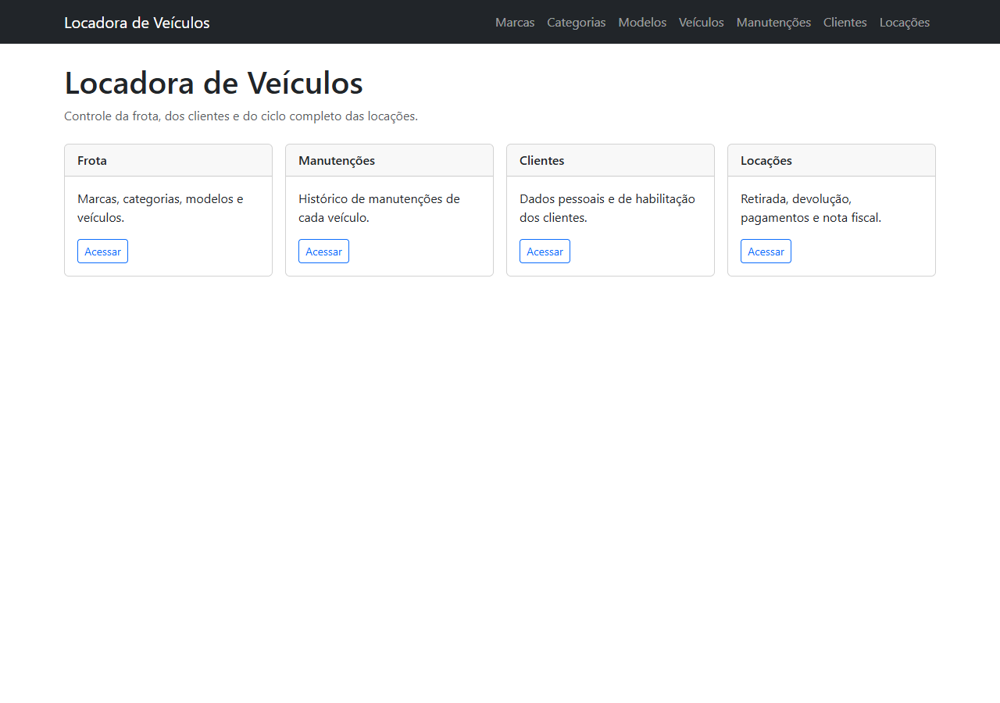
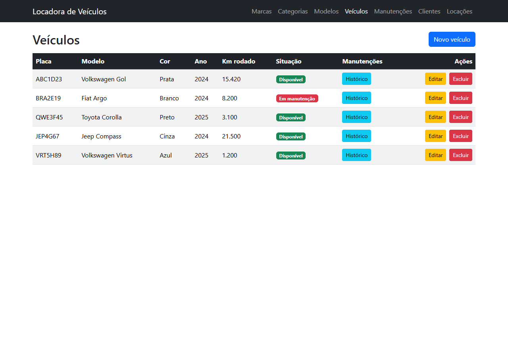
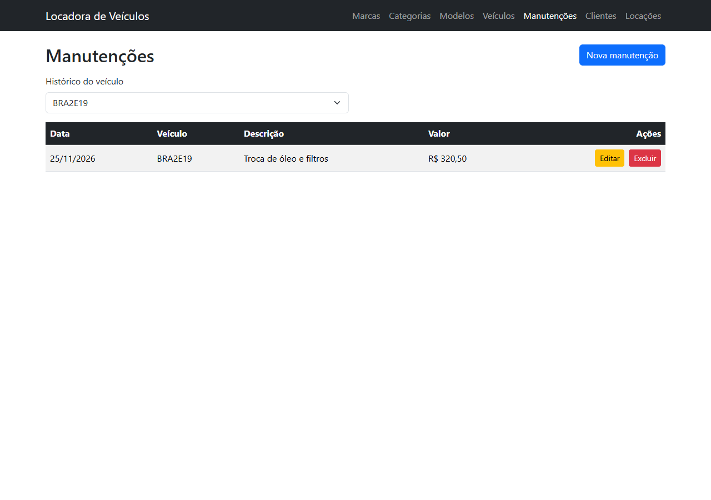
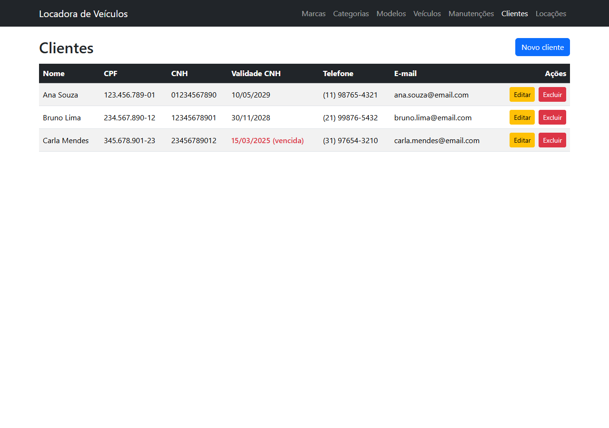
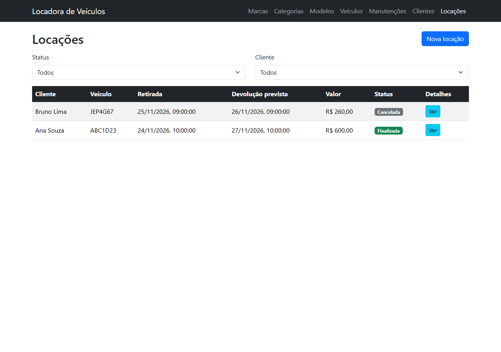
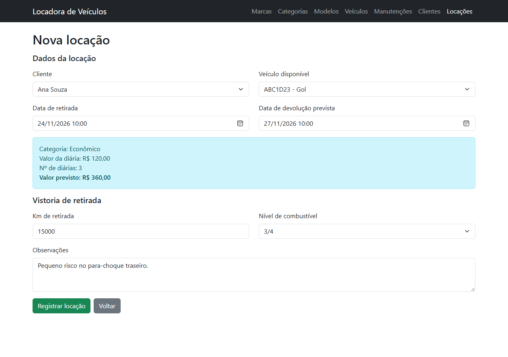
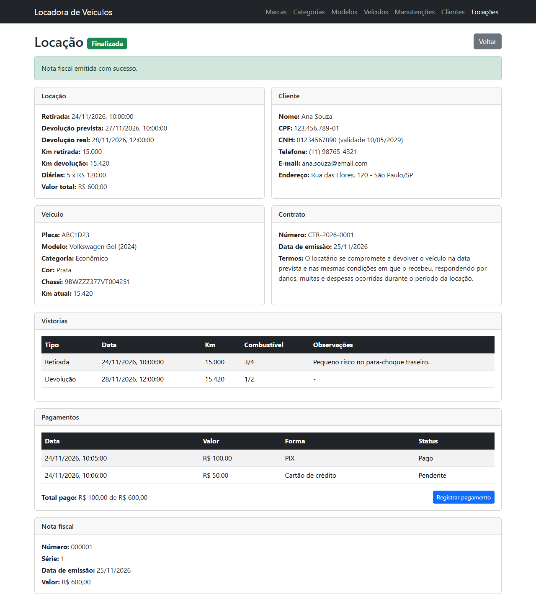
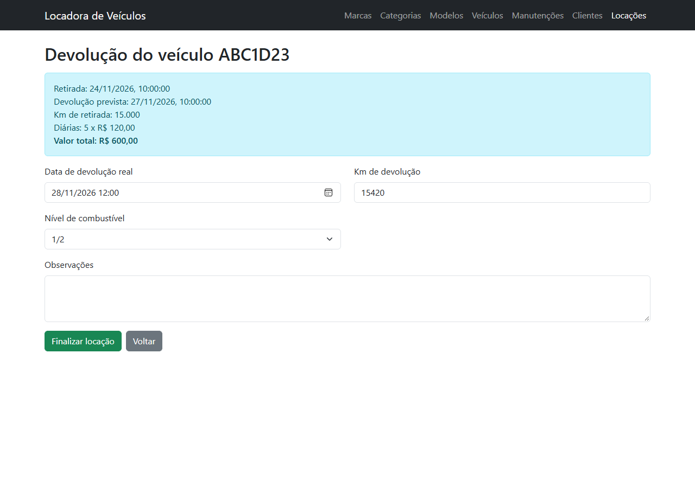

# Locadora de Veículos

**Aluno:** Erick Silva Jube Ribeiro

## Descrição

Aplicação web desenvolvida em React com TypeScript para gerenciar uma locadora de veículos. O sistema controla a frota (marcas, categorias, modelos, veículos e manutenções), os clientes e todo o ciclo de uma locação: registro com contrato e vistoria de retirada, pagamentos, devolução com vistoria e emissão da nota fiscal. A interface usa Bootstrap e os dados são consumidos de uma API REST simulada com JSON Server.

## Como executar

```bash
npm install
npm run server
npm run dev
```

Execute `npm run server` e `npm run dev` em terminais separados.

- Aplicação: `http://localhost:5173`
- API (JSON Server): `http://localhost:3001`

## Telas

### Início


### Veículos


### Manutenções


### Clientes


### Locações


### Nova locação


### Detalhes da locação


### Devolução

